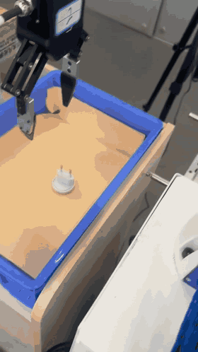

# RealMan π0.5: Full Fine-Tuning and Real-Robot Grasping

[中文项目说明](README.md)

A RealMan VLA engineering project built on LeRobot and [Humble2Full/lerobot-realman-vla](https://github.com/Humble2Full/lerobot-realman-vla), covering demonstration auditing, four-GPU full fine-tuning, checkpoint export, and deployment. The 45,000-step checkpoint has been tested for real-robot grasping. No quantitative success rate is reported yet.

## Real-robot demo (4× speed)

RealMan RM65, 45,000-step checkpoint. Phone-recorded footage, full clip at 4× speed, approximately 32 seconds, muted. [View the MP4](docs/assets/pi05_step45000_4x.mp4). Playback speed does not represent actual robot speed.

## Data and training

- Existing demonstrations collected by a lab colleague: 326 episodes / 178,362 frames.
- Five episodes quarantined for review, without deleting source data.
- Training: 289 episodes / 158,355 frames; held-out validation: 32 episodes / 17,624 frames.
- 144,194 valid starting points for complete 50-action chunks. Normalization statistics use training episodes only.
- π0.5 full fine-tuning: vision, language, and action parameters updated; no LoRA or frozen vision encoder.
- Four RTX 5880 Ada 48GB GPUs, FSDP FULL_SHARD, BF16 mixed precision, FP32 master parameters, gradient checkpointing.
- Per-device batch 2, global batch 8; AdamW, peak LR 1e-5, 500 warmup steps, cosine decay to 1e-6.
- Budget: 54,075 optimizer steps, approximately three passes over valid chunk starts. The 45,000-step checkpoint is the demonstrated model.
- Two current RGB images, task text, and 7D state; predict a 50×7 action chunk. Targets are next-frame measured joint positions and gripper state.

The custom training loop currently records training loss and saves the validation split; it does not automatically evaluate validation loss or task success.

## Hardware

| Device | Role |
|---|---|
| 8×RTX 5880 Ada 48GB server; four GPUs used | Full fine-tuning |
| RTX 4090 workstation | Existing data preparation and earlier experiments |
| RTX 4080 16GB workstation | On-site acquisition/control and deployment |
| RealMan RM65, six joints and gripper | Single-arm grasping experiment |
| Global and wrist RGB cameras | Two-view observations |

The physical platform has three arms; this experiment does not claim three-arm coordination or box folding.

## Reproduction and scope

See the [Chinese README](README.md) for environment setup, data/model locations, smoke training, full training, and checkpoint export. Key files:

- [Pinned dependencies](requirements-train-pi05.txt)
- [Training configuration](configs/pi05_realman.yaml)
- [Data selection](configs/pi05_data_selection.yaml)
- [FSDP entry point](scripts/train_pi05_fsdp.py)
- [Data and flow-matching notes](docs/notes/06_数据与训练原理/README.md)

Data, weights, local environments, and machine-specific exports are not included. Deployment must align camera keys/views, joint ordering, units, gripper direction, and normalization. The inherited inference script requires adaptation to this experiment's camera_global/camera_left inputs.

## Attribution

This fork adds data preparation and statistics isolation, four-GPU full fine-tuning, pinned installation, checkpoint recovery/export, and experiment documentation. Hardware acquisition/conversion code is inherited from Humble2Full; model implementation is provided by Hugging Face LeRobot, based on Physical Intelligence's π0.5. Existing demonstrations and real-robot testing involve lab collaborators.

Upstream ACT results and multi-policy comparisons are not results of this experiment. See [LICENSE](LICENSE) and [THIRD_PARTY_NOTICES.md](THIRD_PARTY_NOTICES.md).
